# The script sheet

The draft of 32 lines laid against the cut list. Lengths are worked out, not measured: 0.105 s a character, 0.5 s for a full stop inside a line, 0.2 s for a comma. On the four measured lines of clip n8 that was off by up to 0.44 s, so a line with less than 0.44 s to spare is called tight.

Marked: 11 of 32 lines (5 too long, 2 tight, 4 for the picture).

| Clip | Place | In the film | Draft | Approved script |
| --- | --- | --- | --- | --- |
| n1 | The opening | 0:00.0 to 0:17.4 | 11.9 s, 111 characters | 11.5 s, 103 characters |
| n2 | The Ribs | 0:17.4 to 0:41.8 | 24.1 s, 213 characters | 20.6 s, 180 characters |
| n3 | The Heart | 0:41.8 to 1:10.3 | 17.8 s, 161 characters | 16.6 s, 149 characters |
| n4 | The Breath | 1:10.3 to 1:33.6 | 19.4 s, 166 characters | 19.0 s, 165 characters |
| n5 | The Blood Marsh | 1:33.6 to 1:56.9 | 16.7 s, 148 characters | 15.1 s, 132 characters |
| n6 | The Spine | 1:56.9 to 2:18.4 | 17.6 s, 156 characters | 16.5 s, 146 characters |
| n7 | The Eye | 2:18.4 to 2:39.0 | 19.1 s, 163 characters | 17.1 s, 144 characters |
| n8 | The Reveal | 2:39.0 to 3:17.7 | 14.4 s, 130 characters | 9.7 s, 88 characters |
| all | | | 140.9 s, 1248 characters | 126.1 s, 1107 characters |

## n1 · The opening

**n1.1** · 0:01.4 to 0:06.1 (4.7 s, over 1.5 s to spare) · Fits

> Past the last calm water, there is a shore.

On: ribs-01 (0:00.0 to 0:17.4).

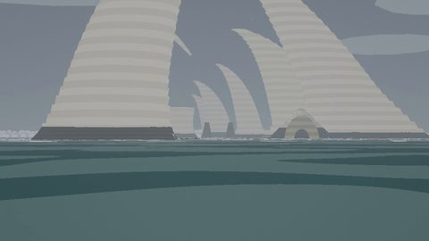 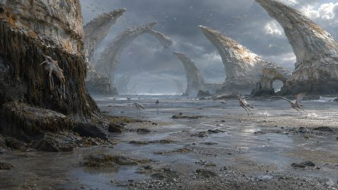

**n1.2** · 0:07.2 to 0:09.8 (2.6 s, over 1.5 s to spare) · Fits

> Nothing on it has a name.

On: ribs-01 (0:00.0 to 0:17.4).

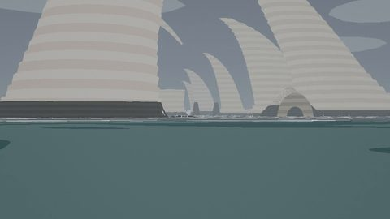 

**n1.3** · 0:10.9 to 0:14.1 (3.1 s, 1.2 s to spare) · Fits

> Nothing on it should be alive.

On: ribs-01 (0:00.0 to 0:17.4).

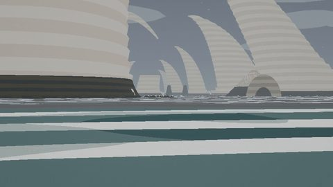 

**n1.4** · 0:15.3 to 0:16.7 (1.4 s, 0.6 s to spare) · Fits

> All of it is.

On: ribs-01 (0:00.0 to 0:17.4). "All of it is." ends 0.7 s before the first strike of the music, where the strait opens at 0:17.4.

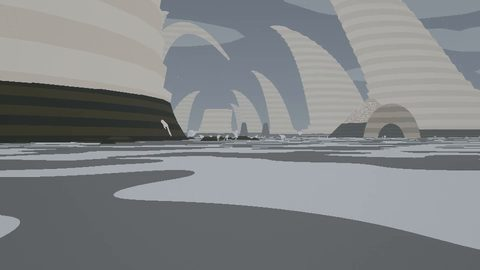 

## n2 · The Ribs

**n2.1** · 0:17.9 to 0:19.1 (1.2 s, 0.8 s to spare) · Fits

> The strait.

On: ribs-02 (0:17.4 to 0:24.0).

**n2.2** · 0:19.7 to 0:26.1 (6.4 s) · Too long

> Blades of stone, taller than the storms that break on them.

On: ribs-02 (0:17.4 to 0:24.0, 4.3 s of the line) then ribs-03 (0:24.0 to 0:27.5, 2.0 s of the line).

 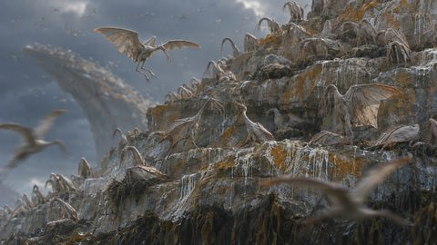

Marked: 6.4 s, and the strait has 4.3 s left after "The strait." and its pause. As written, its last 2 s are said over the colony, and it pushes the feeding line off the feeders.

- A: "Stone blades, taller than the storms." 4.1 s, fits with 0.8 s to spare.
- B: "Stone blades. Storms break on them." 4.2 s, fits with 0.7 s to spare.

**n2.3** · 0:24.4 to 0:32.1 (7.8 s) · Too long

> At low tide the winged ones come down to feed. They do not have long.

On: ribs-03 (0:24.0 to 0:27.5, 3.2 s of the line) then ribs-04 (0:27.5 to 0:31.1, 3.6 s of the line) then ribs-05 (0:31.1 to 0:38.3, 1.0 s of the line).

 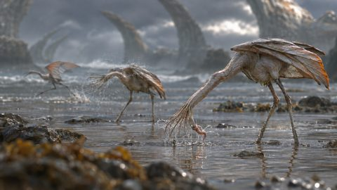

Marked: 7.8 s over two shots that last 7.1 s together, the colony and the feeders. Its last second is said over the drowned, the picture of the next line.

- A: "At low tide the winged ones feed. They do not have long." 6.4 s, fits with 0.9 s to spare.
- B: "At low tide the winged ones come down to feed. Not for long." 6.8 s, fits with 0.5 s to spare. Keeps "come down", and leaves about half the room to spare that the first one leaves.

**n2.4** · 0:32.3 to 0:41.1 (8.8 s, 0.7 s to spare) · Fits

> High in the weed hangs one that stayed. Then the sea returns. All at once.

On: ribs-05 (0:31.1 to 0:38.3, 6.0 s of the line) then ribs-06 (0:38.3 to 0:41.8, 2.8 s of the line). "High in the weed hangs one that stayed." falls wholly on ribs-05, the camera looks up at the drowned. "All at once." runs from 0:39.8 to 0:41.1, across the hit where the bore comes through the cage at 0:40.0.

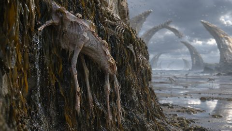 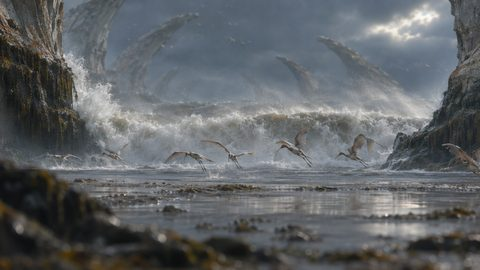

## n3 · The Heart

**n3.1** · 0:42.5 to 0:43.5 (0.9 s, over 1.5 s to spare) · Fits

> The fire.

On: heart-01 (0:41.8 to 0:49.0).

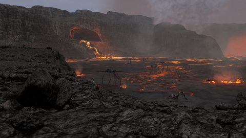

**n3.2** · 0:44.3 to 0:48.0 (3.7 s, 1.5 s to spare) · Fits

> A lake of it, under a black skin.

On: heart-01 (0:41.8 to 0:49.0).

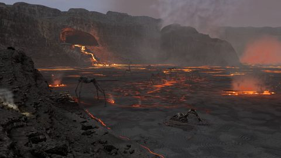

**n3.3** · 0:49.4 to 0:55.4 (6.0 s, 1.3 s to spare) · Fits

> The tall ones walk the skin, and drink from the cracks.

On: heart-02 (0:49.0 to 0:56.3).

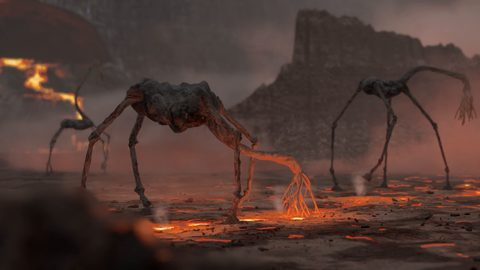

**n3.4** · 0:56.4 to 1:03.6 (7.2 s, 0.1 s to spare) · Picture

> Sometimes the skin gives way. The fire beneath has never cooled.

On: heart-03 (0:56.3 to 0:59.6, 3.3 s of the line) then heart-04 (0:59.6 to 1:03.2, 3.5 s of the line) then heart-05 (1:03.2 to 1:10.3, 0.4 s of the line). "Sometimes the skin gives way." does not fall on heart-04, the one that sank: it runs from 0:56.4 to 0:59.4 and the shot from 0:59.6 to 1:03.2. "The fire beneath has never cooled." does not fall on heart-03, the fire under the skin: it runs from 1:00.0 to 1:03.6 and the shot from 0:56.3 to 0:59.6.

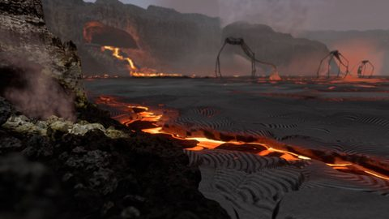 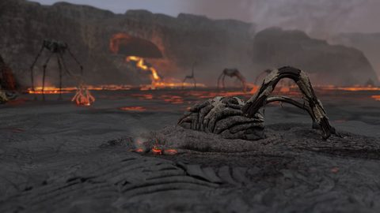

Marked: Its two sentences fall on each other's pictures. The cut shows the fire under the skin first and the one that sank second; the line says the skin gives way first and the fire second. It is also tight: 7.2 s over two shots of 6.9 s.

- A: "The fire has never cooled. Sometimes the skin gives way." 6.4 s, fits with 0.9 s to spare. "The fire has never cooled." falls wholly on heart-03, the fire under the skin. "Sometimes the skin gives way." falls wholly on heart-04, the one that sank.
- B: "The fire beneath has never cooled. Sometimes the skin gives way." 7.2 s, from 0:56.0, tight, 0.2 s to spare. Your own words in the other order. Tight: it has to start in the last quarter second of the shot before. "Sometimes the skin gives way." falls wholly on heart-04, the one that sank.

## n4 · The Breath

**n4.1** · 1:11.0 to 1:11.9 (0.9 s, over 1.5 s to spare) · Fits

> The pits.

On: breath-01 (1:10.3 to 1:16.6).

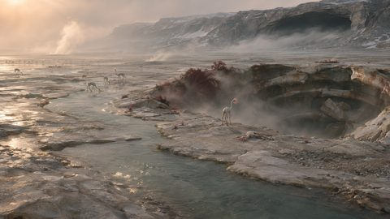

Note: The shot is the shelf with one pit steaming on it. The line says pits.

**n4.2** · 1:12.8 to 1:18.7 (5.9 s, over 1.5 s to spare) · Fits

> The ground breathes here. Slow. From far below.

On: breath-01 (1:10.3 to 1:16.6, 3.8 s of the line) then breath-02 (1:16.6 to 1:21.1, 2.1 s of the line). "From far below." falls wholly on breath-02, down the shaft, it breathes out. "From far below." runs from 1:17.2 to 1:18.7, across the hit where the shaft breathes out at 1:17.5.

 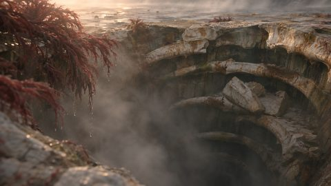

**n4.3** · 1:21.2 to 1:26.5 (5.3 s) · Too long

> Red growth crowds the rim, feeding on the breath.

On: breath-03 (1:21.1 to 1:24.7, 3.5 s of the line) then breath-04 (1:24.7 to 1:30.0, 1.9 s of the line).

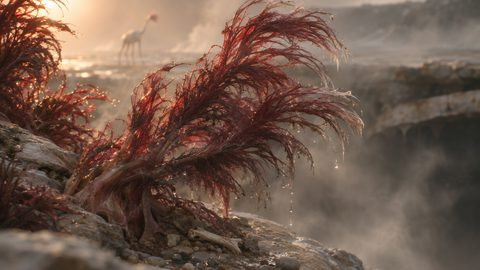 

Marked: 5.3 s on a shot of 3.6 s. Whole, it fits only if it starts at 1:19.3, and then its first 1.8 s are said over the shaft, before the red growth is on screen.

- A: "Red growth feeds on the breath." 3.3 s, fits with 0.6 s to spare.
- B: "Red growth crowds the rim." 2.7 s, fits with 1.1 s to spare.

**n4.4** · 1:25.1 to 1:32.2 (7.1 s, 1.4 s to spare) · Picture

> The pale herds graze the channel, and never the rim. One did.

On: breath-04 (1:24.7 to 1:30.0, 5.0 s of the line) then breath-05 (1:30.0 to 1:33.6, 2.2 s of the line). "One did." falls wholly on breath-05, the one at the rim.

 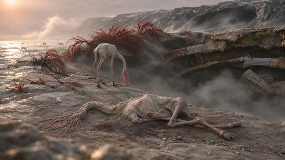

Marked: It fits for length. But the shot it ends on shows two animals at the rim: the dead one the line means, and behind it a living one with its head down, feeding at the rim, as the line says never the rim.

- A: "The pale herds graze the channel, not the rim. One did. One will." 8.0 s, fits with 0.5 s to spare. "One did." falls wholly on breath-05, the one at the rim. "One will." falls wholly on breath-05, the one at the rim.
- B: "The pale herds keep to the channel. One did not. One will not." 7.5 s, from 1:25.6, fits with 0.5 s to spare. 1.1 s of "One did not." (1.3 s) fall on breath-05, the one at the rim.

## n5 · The Blood Marsh

**n5.1** · 1:34.3 to 1:35.7 (1.5 s, 0.6 s to spare) · Fits

> The red flats.

On: marsh-01 (1:33.6 to 1:37.2).

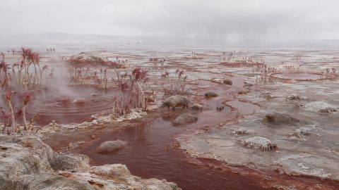

**n5.2** · 1:36.3 to 1:41.9 (5.5 s, 0.6 s to spare) · Picture

> The ground still bleeds here. No rain made this.

On: marsh-01 (1:33.6 to 1:37.2, 0.9 s of the line) then marsh-02 (1:37.2 to 1:40.8, 3.6 s of the line) then marsh-03 (1:40.8 to 1:44.4, 1.1 s of the line). 1.1 s of "No rain made this." (1.9 s) fall on marsh-03, the seep pool bursts. "No rain made this." ends 0.7 s before the hit where the seep pool bursts at 1:42.6.

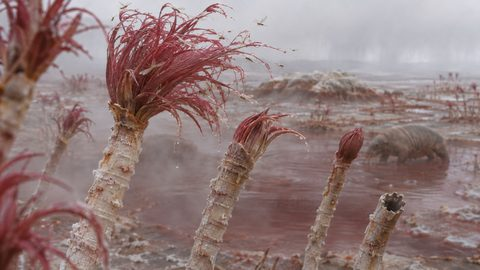 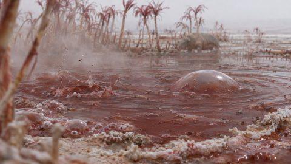

Marked: It fits for length, and it has to end before the pool bursts on the music's strike, so it cannot sit later. But 3.6 of its 5.5 s are said over the stalks, which it does not name. The red they stand in is in view; the stalks are what the shot is about. Each replacement names them and keeps one of your two sentences.

- A: "Stalks root in the red. The ground still bleeds." 5.5 s, from 1:36.5, fits with 0.5 s to spare. 1.7 s of "Stalks root in the red." (2.4 s) fall on marsh-02, the stalks. "The ground still bleeds." ends 0.6 s before the hit where the seep pool bursts at 1:42.6.
- B: "Stalks root in the red. No rain made this." 4.9 s, from 1:37.1, fits with 0.5 s to spare. 2.3 s of "Stalks root in the red." (2.4 s) fall on marsh-02, the stalks. "No rain made this." ends 0.6 s before the hit where the seep pool bursts at 1:42.6.

**n5.3** · 1:44.5 to 1:49.1 (4.6 s, 1.1 s to spare) · Fits

> The heavy ones wallow in it, and grow fat.

On: marsh-04 (1:44.4 to 1:49.8).

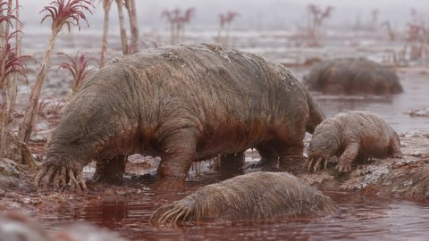

**n5.4** · 1:50.6 to 1:55.7 (5.1 s, 1.2 s to spare) · Fits

> The salt keeps whatever it catches. Forever.

On: marsh-05 (1:49.8 to 1:56.9).

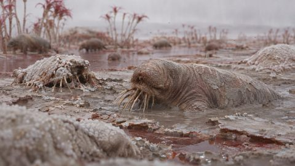

## n6 · The Spine

**n6.1** · 1:57.5 to 1:58.5 (1.1 s, over 1.5 s to spare) · Fits

> The ridge.

On: spine-01 (1:56.9 to 2:02.3).

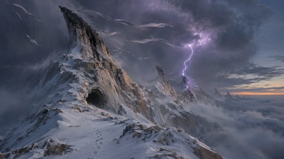

**n6.2** · 1:59.2 to 2:03.1 (4.0 s, over 1.5 s to spare) · Picture

> Above the cloud. Above the storm.

On: spine-01 (1:56.9 to 2:02.3, 3.1 s of the line) then spine-02 (2:02.3 to 2:05.0, 0.8 s of the line). 0.9 s of "Above the storm." (1.7 s) fall on spine-01, the ridge in the storm.

 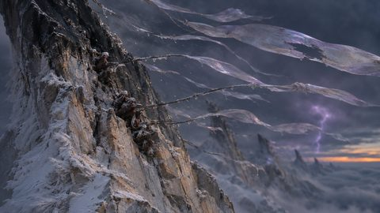

Marked: It fits for length. "Above the cloud" matches: the cloud sea lies below. "Above the storm" does not: the shot is the ridge in the storm, with storm cloud around the spire and lightning on it, and the next line has the lightning walk the ridge.

- A: "Above the cloud. Under the storm." 4.0 s, fits with 1.5 s to spare.
- B: "Above the cloud. Inside the storm." 4.1 s, fits with 1.5 s to spare.

**n6.3** · 2:03.8 to 2:09.7 (5.9 s, over 1.5 s to spare) · Fits

> Every night the lightning walks it. Spire to spire.

On: spine-02 (2:02.3 to 2:05.0, 1.2 s of the line) then spine-03 (2:05.0 to 2:07.7, 2.7 s of the line) then spine-04 (2:07.7 to 2:11.3, 2.0 s of the line). "Spire to spire." falls wholly on spine-04, the strike. "Spire to spire." starts 0.3 s after the hit where lightning, spire to spire at 2:07.8.

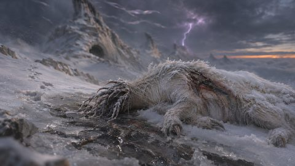 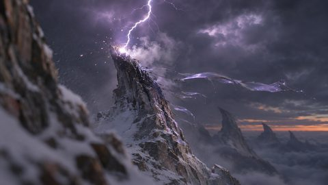

Note: Its first sentence is said over the kites and then over the animal the lightning killed. Neither is named.

**n6.4** · 2:11.4 to 2:18.1 (6.7 s, 0.3 s to spare) · Tight

> The herds shelter in the hollow beneath, and wait for morning.

On: spine-05 (2:11.3 to 2:18.4).

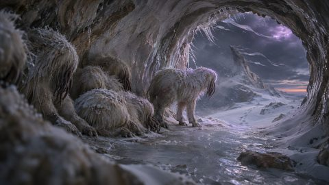

Marked: 6.7 s in a shot of 7.2 s, the last of the place. On paper it fits with 0.3 s to spare, and the estimate has been wrong by more than that. If the read comes out long, its last word is said over the lake.

- A: "The herds shelter in the hollow beneath, until morning." 6.0 s, fits with 1.0 s to spare.
- B: "The herds wait out the night in the hollow beneath." 5.4 s, fits with 1.5 s to spare.

## n7 · The Eye

**n7.1** · 2:18.9 to 2:19.9 (0.9 s, 1.5 s to spare) · Fits

> The lake.

On: eye-01 (2:18.4 to 2:22.0).

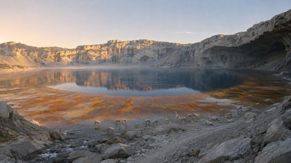

**n7.2** · 2:20.9 to 2:26.6 (5.7 s, 1.1 s to spare) · Fits

> Still. Gold at the edge. Black at the center.

On: eye-01 (2:18.4 to 2:22.0, 1.1 s of the line) then eye-02 (2:22.0 to 2:24.7, 2.7 s of the line) then eye-03 (2:24.7 to 2:27.4, 1.9 s of the line). "Gold at the edge." falls wholly on eye-02, the amber mats. 1.9 s of "Black at the center." (2.1 s) fall on eye-03, the edge.

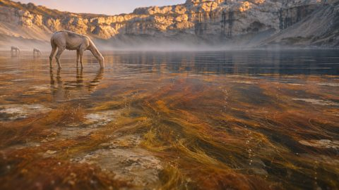 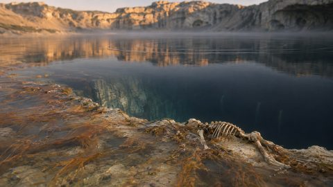

Note: "Black at the center." is said over the edge, where the black water lies behind a skeleton on the lip. The centre itself comes two shots later.

**n7.3** · 2:27.4 to 2:33.9 (6.5 s) · Too long

> The herds drink at the shallows. None of them looks down.

On: eye-04 (2:27.4 to 2:32.8, 5.3 s of the line) then eye-05 (2:32.8 to 2:39.0, 1.2 s of the line).

 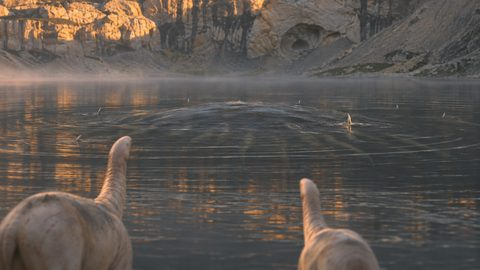

Marked: 6.5 s on a shot of 5.4 s. Its last second is said over the centre, and it pushes the last line of the place past the end of the place.

- A: "The herds drink. None of them looks down." 4.8 s, fits with 0.8 s to spare.
- B: "The herds come to drink. None looks down." 4.8 s, fits with 0.8 s to spare.

**n7.4** · 2:32.9 to 2:38.9 (6.0 s, 0.1 s to spare) · Tight

> The center has no floor. Something there looks back.

On: eye-05 (2:32.8 to 2:39.0).

Marked: 6.0 s in a shot of 6.3 s, the last of the place, and only if the line before it is shortened. On paper it then fits with 0.2 s to spare. If the read comes out long, its last word is said over the first frames of the Reveal.

- A: "The center has no floor. Something looks back." 5.3 s, fits with 0.8 s to spare.
- B: "No floor at the center. Something looks back." 5.2 s, fits with 0.9 s to spare.

## n8 · The Reveal

**n8.1** · 2:40.5 to 2:44.8 (4.3 s) · Too long

> From high enough, the land has a shape.

On: reveal-01 (2:39.0 to 3:15.7).

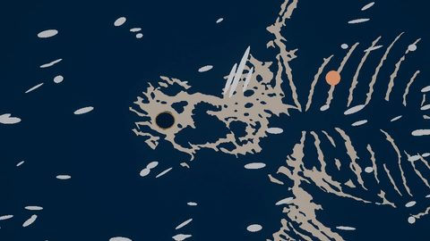 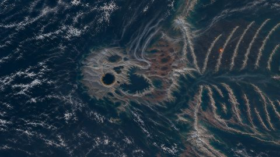

Marked: 4.3 s where 2.8 s are free. It cannot start before the camera has left the water, about 2:40.5, and the line after it has to be out before the strike at 2:47.1. Whole, it fits only from 2:39.0, on the water, where "from high enough" would be said at lake level.

- A: "The land has a shape." 2.2 s, fits with 0.6 s to spare.
- B: "From above, a shape." 2.3 s, fits with 0.5 s to spare.

**n8.2** · 2:43.3 to 2:46.0 (2.6 s, 0.5 s to spare) · Fits

> None of it was ever land.

On: reveal-01 (2:39.0 to 3:15.7). "None of it was ever land." ends 1.1 s before the reveal strike of the music at 2:47.1.

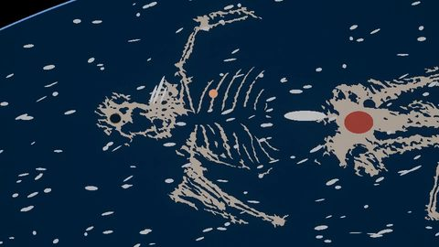 

**n8.3** · 2:47.1 to 2:48.6 (1.5 s, over 1.5 s to spare) · Fits

> It was a body.

On: reveal-01 (2:39.0 to 3:15.7). "It was a body." runs from 2:47.1 to 2:48.6, across the reveal strike of the music at 2:47.1.

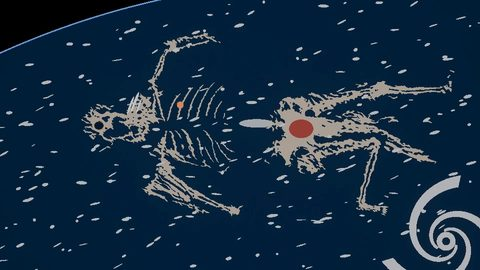 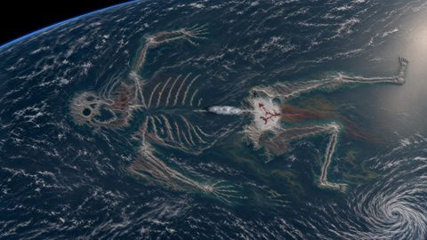

Note: Placed so the line starts on the strike, on the frame where the whole body is in view. The cut's own rule keeps speech clear of the four strikes; it is lifted for this one line when the script is final. If the word "body" should fall on the strike instead, the line starts about 0.6 s earlier.

**n8.4** · 2:57.0 to 3:03.0 (6.0 s, over 1.5 s to spare) · Fits

> Everything here feeds on it. And it is not finished.

On: reveal-01 (2:39.0 to 3:15.7). "And it is not finished." ends 5.9 s before the beat where the Heart's glow pulses once on the body at 3:08.9.

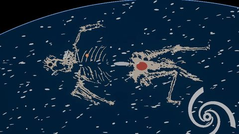 

Note: Placed where the approved script had its last line. It can sit up to 5 s later if the beat should answer "not finished".

## Shown and not named

- heart-05, the vessel mouth and the lava fall, no voice (1:03.2 to 1:10.3): The vessel mouth and the lava fall: 7.2 s with no line, under the biggest peak of the music at 1:06.8. I would leave it without words.
- marsh-02, the stalks (1:37.2 to 1:40.8): The stalks. Line n5.2 is said over them and no line names them. Both replacements for n5.2 do.
- spine-02, the kites (2:02.3 to 2:05.0): The kites streaming from the spire. The end of n6.2 and the start of n6.3 are said over them.
- spine-03, where lightning came to ground (2:05.0 to 2:07.7): The animal the lightning killed. "Every night the lightning walks it." is said over it, which fits in sense, and nothing names the animal.
- eye-03, the edge (2:24.7 to 2:27.4): The skeleton on the lip of the lake. "Black at the center." is said over it.

## The rules of the note, checked on the draft

- No "I", no "you", no people, no maps, no god: met by every line of the draft and by every replacement line.
- Nothing says outright that the land is a body before the Reveal: met. None of the 28 lines before clip n8, and none of their replacements, names a body or a part of one. "Skin", "breathes" and "bleeds" stand as the figures of speech the note asks for.
- Eight clips, four lines each: met.
- About the same length as now: the draft is 140.9 s of speech where the approved script is 126.1 s, by the same estimate. With the first replacement of every marked line it is 130.1 s. No shot moves either way.
- Every line falls on the picture it describes: 21 of the 32 do as written. The other 11 are marked: 5 too long for their shots, 2 with too little to spare and 4 that do not match what the shot shows.
- The third line of the Reveal lands on the reveal strike: it starts on frame 10027, the frame of the strike at 2:47.1.
- Short, blunt lines, and not every line about dying: by my reading 5 of the 32 lines are about dying or the dead (n2.4, n3.4, n4.4, n5.4 and n8.4). The longest line is n2.4, at 8.8 s.
